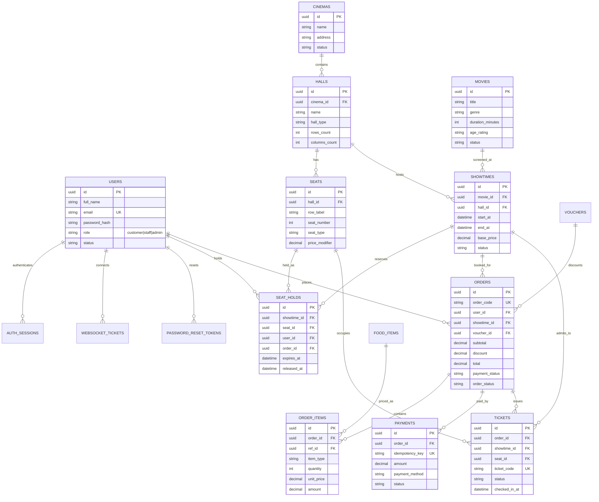

# CineGo database schema

Target database: Supabase PostgreSQL. Apply [`../backend/db/schema.sql`](../backend/db/schema.sql) once to a new project before starting the API. The API does not call `create_all()` and will not mutate production schema at startup.

The design follows the supplied CineGo ERD and use cases: account roles, movie/cinema/hall/seat catalog, scheduled screenings, expiring seat holds, server-priced orders, simulated payments, vouchers, QR tickets, and check-in. All monetary columns use `numeric`; all persisted timestamps use `timestamptz`.

## ERD

## Tables, rules, and indexes

| Table | Responsibility and key integrity rules |
|---|---|
| `users` | Customer/staff/admin identities. Public registration always assigns `customer`; only the trusted admin bootstrap command or an administrator may grant privileged roles. Email is normalized to lowercase. Passwords contain only Argon2 hashes. |
| `auth_sessions` | Server-side session records keyed by JWT `sid`; logout, password reset, and account deactivation revoke sessions. Expired rows can be pruned periodically. |
| `websocket_tickets` | One-time, 30-second credentials for WebSocket connections. The database stores only a SHA-256 hash; unlike access tokens, these short-lived tickets can be used once. |
| `password_reset_tokens` | Hashed, single-use reset tokens with 30-minute expiry. Email delivery requires SMTP configuration. |
| `movies` | Catalog metadata, search/filter fields and visibility status. Referenced movies are deactivated rather than hard-deleted. |
| `cinemas`, `halls` | Cinema address and room layout dimensions. Hall names are unique inside a cinema. |
| `seats` | Static layout positions and seat type. Availability is not a static seat attribute: it is derived per showtime from active holds and issued tickets. |
| `showtimes` | Movie screening, hall, timezone-aware interval and base price. A PostgreSQL GiST exclusion constraint prevents overlapping scheduled screenings in one hall. |
| `seat_holds` | Temporary per-showtime reservations. A partial unique index permits only one unreleased hold per `(showtime_id, seat_id)`; the API also locks seat rows and releases expired holds before reserving. |
| `food_items` | Active menu items, stock and current price. Orders store price snapshots; stock is decremented only on successful simulated payment. |
| `vouchers` | Fixed or percentage discounts, time window, minimum order, cap and usage limit. Voucher usage is serialized and incremented at payment confirmation. |
| `orders`, `order_items` | User booking and server-calculated price snapshots. Seat references are represented by the associated holds and issued tickets; food/combo lines reference menu entries. |
| `payments` | Mock-only payment attempts, each identified by a unique idempotency key. No card/bank credentials or real payment data are accepted. |
| `tickets` | One ticket per sold seat. `(showtime_id, seat_id)` is unique; QR payload is a high-entropy UUID signed with an independent HMAC secret. Ticket status transitions atomically from issued to checked-in. |

### Operational notes

- PostgreSQL row locks plus uniqueness constraints arbitrate concurrent seat holds and check-in requests. The constraints remain authoritative even when multiple API requests race.
- A background expiry worker releases stale holds about once per second and broadcasts the changed seats; reservation attempts also release expired rows before inserting. For large multi-instance production deployments, move this worker and broadcast to a shared queue/pub-sub service; do not rely on clients disconnecting.
- The `showtimes` exclusion constraint requires PostgreSQL's `btree_gist` extension. The schema enables it before creating the constraint.
- Supabase should be accessed only by this backend using a private database connection string. Do not expose Supabase service-role credentials or database credentials in the browser.
- Row-level security is enabled for every application table, with no client-facing policies. The Supabase Data API therefore denies `anon`/`authenticated` row access; the backend's private database connection is the sole application data-access path. Do not add broad RLS policies or expose the database credentials to the frontend.
- Schema changes are currently a versioned initial SQL script, not an automatic migration system. Create a new migration for future changes and back up before applying it.
